

  

  
  
  

  

I work on machine learning and software. My research is in quantum machine learning and quantum error correction, and most of my code is in Python, TypeScript, React and Rust.

  

## Featured software

<table>
  <tr>
    <td width="50%" valign="top">
      <a href="https://isaac3d.com">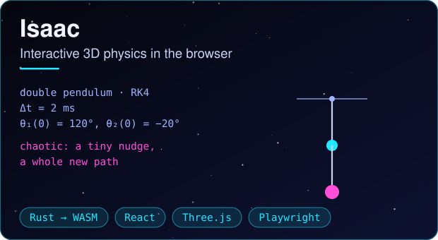</a>
      
Interactive physics simulations for students, with live graphs and equations. Physics core in Rust compiled to WebAssembly; interface in React, TypeScript and Three.js; physics validated with <code>cargo test</code>, unit tests in Vitest and end-to-end tests in Playwright.

      
<a href="https://isaac3d.com"><b>isaac3d.com</b></a>

    </td>
    <td width="50%" valign="top">
      <a href="https://amadeosheets.com"></a>
      
Turns audio recordings into editable sheet music, all in the browser: neural pitch detection on TensorFlow.js, key and chord estimation, export to PDF, MusicXML and MIDI. React and TypeScript, nine languages, cross-browser Playwright tests.

      
<a href="https://amadeosheets.com"><b>amadeosheets.com</b></a>

    </td>
  </tr>
  <tr>
    <td width="50%" valign="top">
      
      
Backtests trading strategies on out-of-sample data with walk-forward windows, fees and slippage, and uses block-bootstrap tests to check that results are not due to chance. Python, pandas, FastAPI and SQLite, with 221 pytest tests.

      
Private repository.

    </td>
    <td width="50%" valign="top">
      
      
Desktop app that sends requests to a separate AI coding agent for each project. Data is encrypted at rest, updates are signed, and CI runs on Windows, macOS and Linux. Node.js and Electron.

      
Private repository.

    </td>
  </tr>
</table>

  

## Research

  <a href="https://github.com/matheusrteixeira-dev/Quantum-Machine-Learning-Applications-in-Healthcare"></a>

**[Quantum Machine Learning Applications in Healthcare](https://github.com/matheusrteixeira-dev/Quantum-Machine-Learning-Applications-in-Healthcare)**: code for my M.Sc. dissertation. A hybrid quantum-classical pipeline for breast cancer histopathology, with the data split by patient so that no patient appears in both training and test sets.

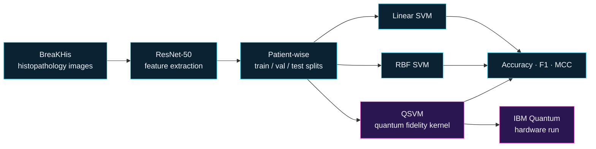

**[Quantum Classifier for the Iris Dataset](https://github.com/matheusrteixeira-dev/Quantum-Classifier-for-Iris-Dataset)**: my B.Sc. final project, a quantum support vector machine for the Iris dataset.

### Publication

  

## Skills

  

<b>All tools</b>

 

#### Machine Learning and Data

  
  
  
  
  
  
  
  
  
  
  

#### Quantum Computing

  
  
  
  

#### Programming Languages

  
  
  
  
  
  
  

#### Web, Apps and Backend

  
  
  
  
  
  
  
  
  
  
  

#### Databases

  
  
  
  

#### Testing and Tools

  
  
  
  
  
  
  
  
  

## Coursework

  
  <a href="https://github.com/matheusrteixeira-dev/Computer-Science-FEI"></a>

  

  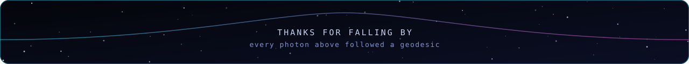

