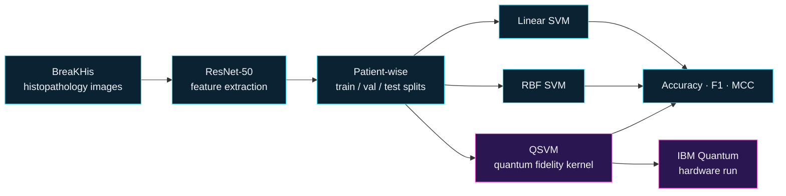

  

  
  
  

I build reproducible machine learning pipelines and tested, production-quality software. 
My research is in quantum machine learning and quantum error correction; my engineering work spans 
Python, TypeScript, React and Rust compiled to WebAssembly.

## Right now

<table>
  <tr>
    <td width="33%" valign="top">
      <b>Ph.D. in Electrical Engineering</b> 
      Centro Universitário FEI · CAPES scholarship  
      Enrolled; classes begin in February 2027. Quantum error correction and machine learning decoders, with a sandwich year planned at ETH Zurich (2028–2029).
    </td>
    <td width="33%" valign="top">
      <b>MBA in Data Science, AI and Analytics</b> 
      USP/Esalq · in progress  
      Applied statistics, machine learning and analytics, alongside an M.Sc. in Electrical Engineering (AI) and a B.Sc. in Computer Science, both from FEI.
    </td>
    <td width="33%" valign="top">
      <b>Building for the browser</b> 
      Rust · WebAssembly · TypeScript · TensorFlow.js  
      Interactive physics and music tools that run entirely client-side, backed by seven years of professional web, database and IT work.
    </td>
  </tr>
</table>

## Featured software

<table>
  <tr>
    <td width="50%" valign="top">
      
      
Students change parameters and watch physics respond, with live graphs and equations. Physics core in Rust compiled to WebAssembly; interface in React, TypeScript and Three.js; physics validated with <code>cargo test</code>, unit tests in Vitest and end-to-end tests in Playwright.

      
<a href="https://isaac3d.com"><b>isaac3d.com</b></a>

    </td>
    <td width="50%" valign="top">
      
      
Transcribes recordings into editable scores without leaving the browser: neural pitch detection on TensorFlow.js, key and chord estimation, export to PDF, MusicXML and MIDI. React and TypeScript, nine languages, cross-browser Playwright tests.

      
<a href="https://amadeosheets.com"><b>amadeosheets.com</b></a>

    </td>
  </tr>
</table>

<b>Also built</b> (private repositories, happy to walk through them in an interview)

 

| Project | What it does | Stack |
| --- | --- | --- |
| **Allwinner** | Scores trading strategies with walk-forward, out-of-sample backtests and block-bootstrap significance tests | Python, pandas, FastAPI, SQLite, 221 pytest tests |
| **Brectus** | Desktop app that orchestrates AI coding agents per project, with encryption at rest and signed updates | Node.js, Electron |
| **Business websites** | Company sites with WCAG 2.2 AA accessibility tests and Lighthouse scores of 95 and above | Astro, TypeScript, Cloudflare Pages |

## Research

### [Quantum Machine Learning Applications in Healthcare](https://github.com/matheusrteixeira-dev/Quantum-Machine-Learning-Applications-in-Healthcare)

Reproducible hybrid quantum-classical pipeline for breast cancer histopathology classification on BreaKHis (M.Sc. dissertation).

  
  
  
  

### [Quantum Classifier for the Iris Dataset](https://github.com/matheusrteixeira-dev/Quantum-Classifier-for-Iris-Dataset)

B.Sc. final project: a Quantum Support Vector Machine for the Iris dataset, with quantum feature maps, kernel-based classification and model evaluation.

## Publication

> **Systematic Review of Quantum Machine Learning for Healthcare** 
> Matheus Teixeira, Reinaldo A. C. Bianchi 
> 36th Brazilian Conference on Intelligent Systems (BRACIS 2026), Cuiabá, Brazil, October 2026.

## Tech stack

#### Machine Learning and Data

  
  
  
  
  
  
  
  
  
  
  

#### Quantum Computing

  
  
  
  

#### Programming Languages

  
  
  
  
  
  
  

#### Web, Apps and Backend

  
  
  
  
  
  
  
  
  
  
  

#### Databases

  
  
  
  

#### Testing and Tools

  
  
  
  
  
  
  
  
  

## Coursework

[M.Sc. Artificial Intelligence](https://github.com/matheusrteixeira-dev/MSc-Artificial-Intelligence) · [Computer Science](https://github.com/matheusrteixeira-dev/Computer-Science-FEI)

## Research interests

`Quantum Error Correction` · `Machine Learning Decoders` · `Quantum Machine Learning` · `Healthcare AI` · `Computer Vision` · `Reproducible Research`

  

